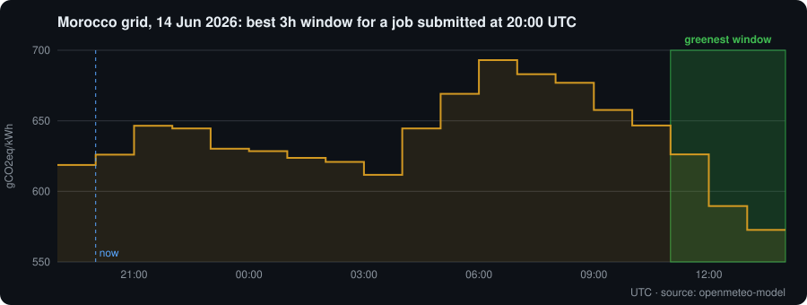
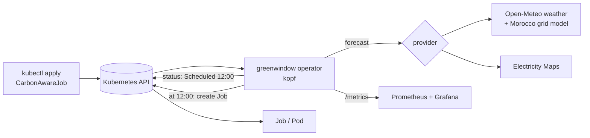

# greenwindow

[](https://github.com/Schaib03/greenwindow/actions/workflows/ci.yml)


**Run Kubernetes batch jobs when the grid is cleanest.**

A nightly report, a model training run or a backup rarely has to start at an exact time:
it has to be done by some deadline. The same kilowatt-hour can emit very different
amounts of CO2 depending on when it is consumed, because the mix of sun, wind, coal and
gas on the grid changes hour by hour. greenwindow is a Kubernetes operator that holds
those jobs until the greenest window before their deadline, then runs them.

It works for Morocco out of the box, with no API key: it estimates the national grid's
carbon intensity from the weather forecast at Noor Ouarzazate and at three large wind
farms. Other zones work through the Electricity Maps API.



*Real Open-Meteo forecast for 14 June 2026, run through the grid model. A 3-hour job
submitted at 20:00 UTC with an 18-hour deadline is moved to midday, when Noor's solar
output pushes coal and gas down: 639 → 596 gCO2eq/kWh.*

## How it works



1. You create a `CarbonAwareJob`: a normal Job template plus `duration`, `deadline`, and
   optionally `powerWatts` and `maxIntensity`.
2. The operator fetches the forecast and slides a window of length `duration` over it,
   keeping the job inside the deadline. It picks the start with the lowest average
   intensity, and records the decision in the resource status.
3. Every 20 minutes it re-plans with a fresh forecast, in case the weather changed.
4. When the start time comes, it creates the Job (owned by the `CarbonAwareJob`, so
   deleting one deletes the other) and follows it until it succeeds or fails.

From the end-to-end test in CI, where the static forecast is clean between minutes 4
and 6 (`-o wide` adds the intensity if it had started immediately):

```console
$ kubectl get cajob demo -o wide
NAME   PHASE       START                  GCO2/KWH   NOW   AVOIDED (G)   AGE
demo   Succeeded   2026-11-19T18:03:00Z   150        600   3.8           3m41s
```

## Quick start

On any cluster (kind works):

```bash
helm install greenwindow deploy/chart/greenwindow -n greenwindow --create-namespace
kubectl apply -f examples/nightly-report.yaml
kubectl get cajob nightly-report -o yaml     # see the decision in .status
kubectl get events --field-selector involvedObject.name=nightly-report
```

```yaml
apiVersion: greenwindow.io/v1alpha1
kind: CarbonAwareJob
metadata:
  name: nightly-report
spec:
  zone: MA
  duration: 45m        # expected run time
  deadline: 10h        # must be finished within 10h of creation
  powerWatts: 300      # only used to estimate the CO2 avoided
  maxIntensity: 450    # optional: if the grid is already this clean, start now
  jobTemplate:         # same as a CronJob's jobTemplate
    spec:
      template:
        spec:
          restartPolicy: Never
          containers:
            - name: report
              image: busybox:1.37
              command: ["sh", "-c", "echo building the daily report"]
```

The planner also works without a cluster:

```console
$ pip install -e .
$ greenwindow forecast
MA  openmeteo-model  24h ahead
▂▁▁▂▃▄▅▇▇▆▆▆█▇▆▆▅▄▃▃▃▃▄▄▄  627–755 gCO2eq/kWh

Thu 17:00Z     647  ░░░░░░░░░
Thu 18:00Z     636  ░░░░░░
Thu 19:00Z     627  ░░░░
Thu 20:00Z     645  ░░░░░░░░
Thu 21:00Z     663  ░░░░░░░░░░░░░
...
$ greenwindow plan --duration 2h --deadline 18h --power-watts 400 --svg plan.svg
```

`plan` marks the chosen window with `◀ run`, prints the intensity drop and the CO2
avoided, and `--svg` writes a chart like the one above.

## The Morocco grid model

There is no free hourly carbon-intensity feed for Morocco, so `grid_model.py` estimates
one:

- **Solar**: 900 MW, driven by irradiance at Noor Ouarzazate.
- **Wind**: 2 GW, from the 100 m wind speed at Tarfaya, Khalladi (Tangier) and Essaouira
  through a standard turbine power curve.
- **Demand**: a typical daily profile in local time (UTC+1) with an evening peak.
- **Dispatch**: renewables first, coal is must-run down to 55 % (Morocco's coal plants run
  as baseload), gas covers the rest. When renewables exceed what is left, they are
  curtailed.
- **Emission factors**: IPCC lifecycle medians (coal 820, gas 490, solar 40, wind 11,
  hydro 24 gCO2eq/kWh).

The result lands around 550 to 750 gCO2eq/kWh, in line with Morocco's coal-heavy mix. It
is an estimate meant to rank hours against each other, not to report emissions, and
every capacity is a parameter of `GridParams`. Known simplifications: CSP storage at Noor
(which shifts some solar to the evening), imports from Spain and seasonal hydro are not
modelled.

Because coal dominates, shifting a job usually saves 5 to 15 % in Morocco. On grids with
more variable renewables (Spain, Germany, California) the same approach saves 30 % or more,
which is why the Electricity Maps provider exists.

## Configuration

| Helm value | Default | |
| --- | --- | --- |
| `provider` | `openmeteo` | `openmeteo`, `electricitymaps` or `static` |
| `electricityMaps.existingSecret` | | Secret holding the API token |
| `staticForecast` | | e.g. `step=1h;620,610,540,560` (tests and demos) |
| `reconcileSeconds` | `30` | How often scheduled and running jobs are checked |
| `replanMinutes` | `20` | How often a held job is re-planned |
| `metrics.serviceMonitor.enabled` | `false` | Prometheus Operator scraping |
| `grafanaDashboard.enabled` | `false` | Ships a Grafana dashboard as a ConfigMap |

Metrics: `greenwindow_grid_intensity_gco2_per_kwh`, `greenwindow_jobs_scheduled_total{reason}`,
`greenwindow_avoided_co2_grams_total`, `greenwindow_start_delay_seconds`,
`greenwindow_jobs_finished_total{phase}`.

## Design decisions

**Fail open.** If the forecast cannot be fetched, the job runs now. A carbon optimisation
must never be the reason a business job misses its deadline.

**Do not wait for nothing.** A job is only held if the best window is at least 5 % cleaner
than running now. Waiting ten hours to save 1 % is a bad trade.

**Decisions are pure functions.** `scheduler.py` and `operator/reconcile.py` take a
forecast and a clock and return a decision; they never call Kubernetes. The kopf handlers
are a thin layer on top. That is why most of the logic is covered by fast unit tests, and
why the end-to-end test only has to prove the wiring.

**State lives in the resource status.** Planned start, deadline, intensities and job name
are in `.status`, so the operator can restart at any moment and pick up where it left
off. Job creation is idempotent (a deterministic name, and `409 Conflict` is treated as
"already created").

**One replica.** Two operators would race to create the same Jobs. The Deployment uses a
single replica with the `Recreate` strategy; leader election would be the next step for
high availability.

**Forecasts are cached** for 30 minutes per zone: weather forecasts do not change faster
than that, and it keeps the operator polite with free APIs.

## Testing

```bash
pip install -e ".[dev]"
pytest               # 70 unit tests: forecast maths, planner, grid model, providers, handlers, CLI
ruff check . && ruff format --check .
```

CI also runs an end-to-end scenario on a real kind cluster (`tests/e2e/run.sh`): it
installs the chart with a static forecast that is dirty for four minutes and then clean,
creates a job allowed to wait ten minutes, and checks that the job is held, started inside
the clean window, owned by its `CarbonAwareJob`, and succeeds.

## Project layout

```
src/greenwindow/
  forecast.py         piecewise-constant forecast, time-weighted averages
  scheduler.py        window search, thresholds, avoided-CO2 estimate
  grid_model.py       Morocco grid model
  providers/          openmeteo (model), electricitymaps, static, caching
  operator/           kopf handlers, pure reconcile logic, Prometheus metrics
  cli.py, chart.py    command line, terminal and SVG charts
deploy/chart/         Helm chart with the CRD, RBAC and Grafana dashboard
examples/             sample CarbonAwareJobs
tests/                unit tests and the kind end-to-end script
```

## Ideas for later

- Carbon-aware CronJobs: a schedule plus a flexibility window.
- Pick the greenest region as well as the greenest hour for multi-cluster setups.
- Model CSP storage at Noor and imports through the Spain interconnector.

## License

MIT
